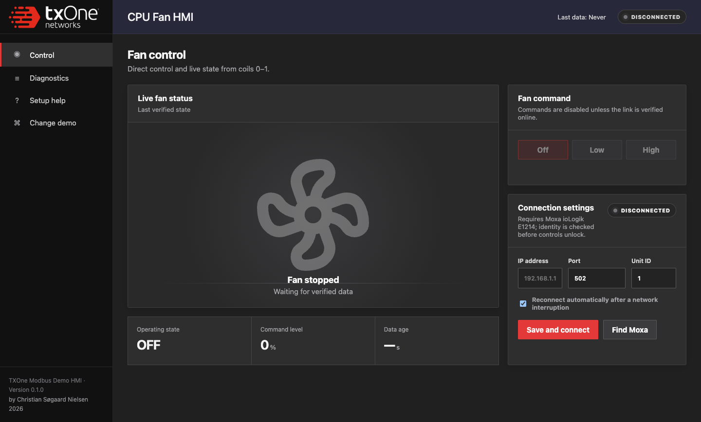
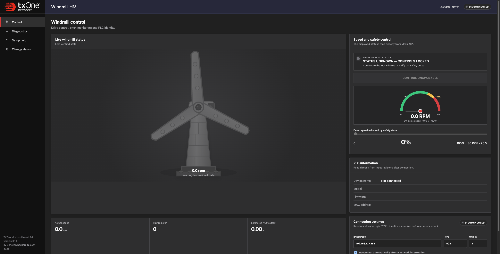

# TXOne Modbus Demo HMI

Cross-platform desktop HMI for two TXOne industrial-security demonstrations:

- **CPU Fan** — coil-based off, low, and high-speed control using a Moxa ioLogik E1214.
- **Windmill** — analog drive control, live RPM, tower-light thresholds, emergency stop, and an intentional overspeed/attack scenario using a Moxa ioLogik E1241.

The operator selects one demonstration at a time. Only the selected demo can connect to hardware or send commands.

> This application is demonstration software. It is not a safety system. A physical emergency-stop circuit must remain independent of the HMI and network.

## Screenshots

### CPU Fan demo



### Windmill demo



## Highlights

- Native desktop packages for macOS and 64-bit Windows.
- Direct Modbus TCP communication; no browser server or cloud connection is required.
- Remembers IP address, port, Unit ID, selected demo, and reconnect preference locally.
- Finds Moxa devices on active `/24` IPv4 networks and checks the remembered and factory-default addresses.
- Reads Moxa identity registers and rejects the wrong ioLogik model before enabling controls.
- Marks telemetry stale and locks commands immediately after communication failure.
- Automatically reconnects with bounded exponential backoff when enabled.
- Keeps the windmill animation smooth and independent from the one-second Modbus polling cycle.
- Provides in-app diagnostics, setup help, and a persistent local event log.

## Download and install

Download the package for your computer from the repository's **Releases** page:

- **macOS Apple Silicon:** `TXOne Modbus Demo HMI-<version>-arm64.dmg`
- **Windows installer:** `TXOne Modbus Demo HMI Setup <version>.exe`
- **Windows portable:** `TXOne Modbus Demo HMI <version>.exe`

The current development packages are unsigned, so macOS Gatekeeper or Windows SmartScreen may display a warning. See [Installation](docs/INSTALLATION.md) for exact steps and the requirements for signed partner releases.

## First use

1. Connect the computer and Moxa ioLogik to the same untagged network/VLAN.
2. Open the app and select **CPU Fan** or **Windmill**.
3. Open **Connection settings**.
4. Enter the ioLogik IP address, normally port `502` and Unit ID `1`, or select **Find Moxa**.
5. Confirm that the detected model is correct:
   - CPU Fan: `E1214` or `E1214-T`
   - Windmill: `E1241` or `E1241-T`
6. Select **Save and connect**.
7. Verify that the status is **ONLINE** and that live telemetry has a recent timestamp before operating the demo.

The factory-default Moxa address checked by discovery is `192.168.127.254`. Your computer must have a compatible address, for example `192.168.127.240/24`, when connecting directly without a router.

Detailed guides:

- [Installation](docs/INSTALLATION.md)
- [Demo setup and operation](docs/DEMO_SETUP.md)
- [Troubleshooting](docs/TROUBLESHOOTING.md)
- [Architecture and network resilience](docs/ARCHITECTURE.md)

## Windmill scaling and attack scenario

The normal operator range is deliberately limited to the validated demo range:

| Raw AO value | Voltage | Rated speed | Display |
| ---: | ---: | ---: | --- |
| `0` | 0 V | 0 RPM | stopped |
| `3072` | 7.5 V | 30 RPM | 100% rated speed |
| `4096` | 10 V | 40 RPM | 133%, red overspeed/possible attack |

The HMI cannot command above `3072`. An external write up to `4096` is still read and displayed, allowing the security demonstration to show a compromised process moving beyond its safe operator limit.

## Development

Node.js 20 or newer is recommended.

```sh
npm install
npm test
npm run check
npm start
```

Build packages locally:

```sh
npm run dist:mac
npm run dist:win
```

`dist:mac` produces an Apple Silicon `.dmg` and `.zip`. `dist:win` produces a 64-bit NSIS installer and a portable `.exe`. The Windows build omits `modbus-serial`'s optional serial-port driver because this application uses Modbus TCP only.

GitHub Actions also builds both platforms on demand and attaches packages to releases created from `v*` tags.

## Project layout

- `src/main/connection-manager.cjs` — reconnect and stale-data state machine.
- `src/main/device-profiles.cjs` — Modbus register/coil maps and model validation.
- `src/main/discovery.cjs` — cross-platform ARP parsing and bounded network probing.
- `src/main/index.cjs` — Electron lifecycle, settings, IPC, logging, and discovery orchestration.
- `src/renderer/` — TXOne-style operator interface.
- `test/` — protocol, discovery, safety-limit, and connection-state tests.
- `cpufan/` and `windmill/` — original implementations retained as design and protocol references.

## Author

Christian Søgaard Nielsen, 2026.
